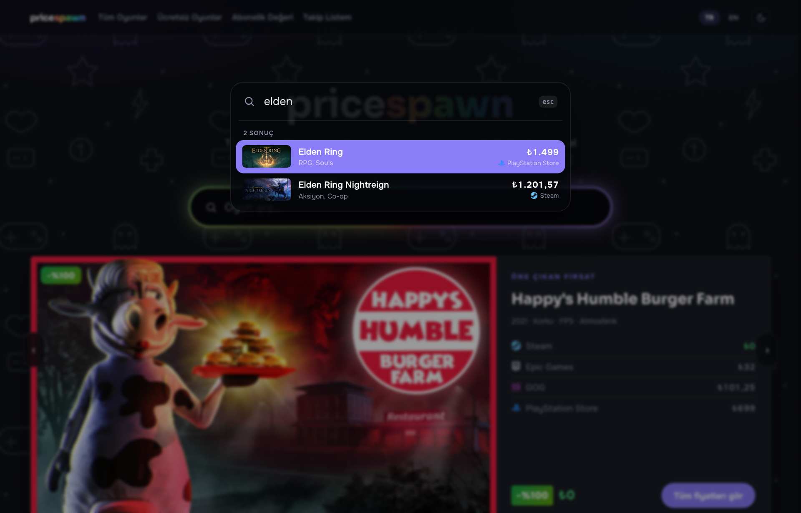
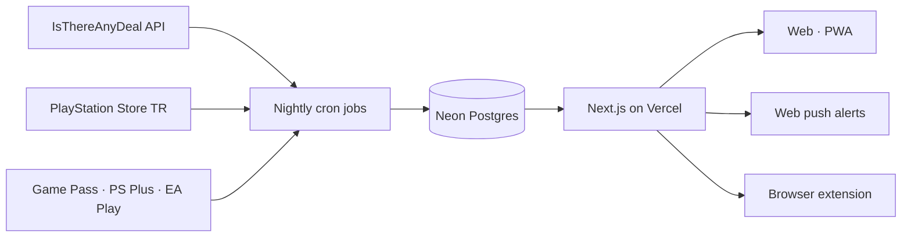

  
  
  
  

<em>Real Turkish lira prices for every game, across every digital store, side by side. 
This repository is the public showcase; the source code is kept private.</em>

## The question it answers

Buying a game in Türkiye means checking eight shops that all price in lira differently, run different sales and bundle different subscriptions. PriceSpawn puts them in one row per store: **Steam, Epic Games, GOG, Xbox Store, PlayStation Store, Ubisoft Store, EA App and Humble Store**, each with its current price, its own discount and a link straight to the product.

Then it answers the harder question: *should I buy this now?* A decision card on every game page gives a Buy / Wait verdict measured against the game's all-time low, the cost per hour of the main story, and a forecast of when the next discount is likely to land.

> **No price here is fake.** Prices, discounts, historic lows and free games come from live sources and are refreshed every night. Where something is still being measured, the page says so instead of drawing a pretty guess.

## A look around

<table>
  <tr>
    <td width="50%"></td>
    <td width="50%"></td>
  </tr>
  <tr>
    <td align="center">Game page · every store, one row</td>
    <td align="center">Browse · filters in the URL</td>
  </tr>
  <tr>
    <td width="50%"></td>
    <td width="50%"></td>
  </tr>
  <tr>
    <td align="center">Subscriptions · what a membership is worth</td>
    <td align="center">⌘K · search from anywhere</td>
  </tr>
</table>

## Highlights

| | |
|---|---|
| **Real Turkish prices** | Live lira prices from eight stores, never a dollar estimate. |
| **Buy / Wait verdict** | Four levels (*record low*, *buy*, *okay*, *wait*) from how far the price sits above the all-time low and how deep the cut is. Console prices are never compared with a PC-only low. |
| **Discount forecast** | Reads the game's own price history, finds when it usually drops and snaps the estimate to the known sale calendar. |
| **Historic low** | Each game's true all-time low with store and date, counted from the start of Steam's lira era. |
| **Free games** | What is free right now, with countdowns to the real end date and a "hurry" state in the last 48 hours. |
| **Subscription value** | What Game Pass, PS Plus and EA Play include, what those games would cost without them, and which games join or leave. |
| **Watchlist and alerts** | Set a target price, get a web push when it is hit. No account. |
| **Steam import** | Paste a Steam profile to bring in your library or your wishlist, priced live. |
| **Ne Oynasam?** | A game picker that filters by score, budget, genre and length, and sorts by the cheapest hour of play. |
| **Deal desk** | A curated deal list that ignores asset flips: a game needs real review volume first. |
| **Search, filters, themes** | A ⌘K palette with Turkish-aware matching, filters for Turkish language and Steam Deck, seasonal skins, light and dark. |
| **Browser extension** | *PriceSpawn Asistan* shows the cheapest lira price while you browse Steam or Epic. |

## Honest data, by rule

| Rule | What it prevents |
|---|---|
| A discount counts only when it agrees with the row's own prices. | A store reporting a cut next to an undiscounted price would otherwise trigger a fake "on sale". |
| Every price carries a freshness level: fresh, aging or stale. | Anything a nightly job missed is labelled, not hidden. |
| Lows from before Steam's switch to lira pricing are not stored. | Old regional prices would make every modern price look terrible. |
| A deal needs real review volume. | The top of a −95 % list would otherwise be asset flips. |
| A health check watches that prices are actually being written. | Silent failures (a full database, a scrape returning zero) get caught. |

## Under the hood

Built with Next.js (App Router), Neon Postgres and IsThereAnyDeal data, deployed on Vercel. Two languages (TR / EN), installable as a PWA.

## Türkçe özet

**PriceSpawn**, bir oyunun Türkiye'deki sekiz dijital mağazadaki (Steam, Epic, GOG, Xbox, PlayStation, Ubisoft, EA App, Humble) gerçek TL fiyatını tek sayfada karşılaştıran bir fiyat takip sitesi. Her oyun sayfasında tarihî en düşük fiyata göre "Al / Bekle" önerisi, ana hikâyenin saat başı maliyeti ve bir sonraki indirim tahmini var. Ücretsiz oyunlar, abonelik değeri, Steam kütüphanesi içe aktarma, "Ne Oynasam?" ve hesapsız fiyat alarmı da var. Veriler her gece yenileniyor, hiçbir fiyat uydurma değil. Bu depo sitenin vitrini; kaynak kod gizli.

 

Showcase only · price data via IsThereAnyDeal and the stores themselves · the game in the banner is invented.

