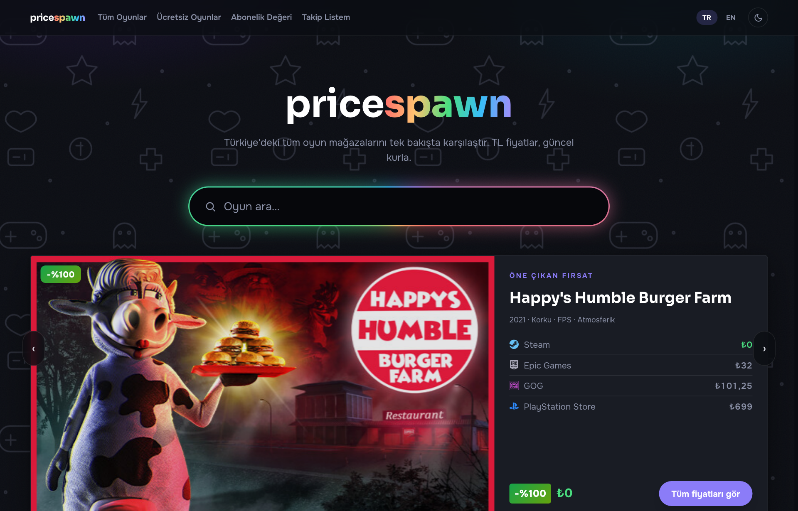
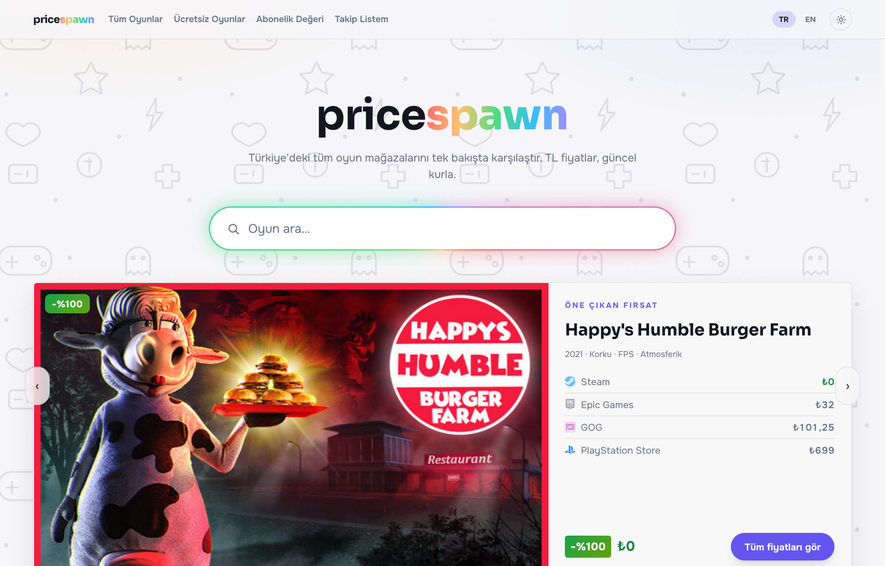
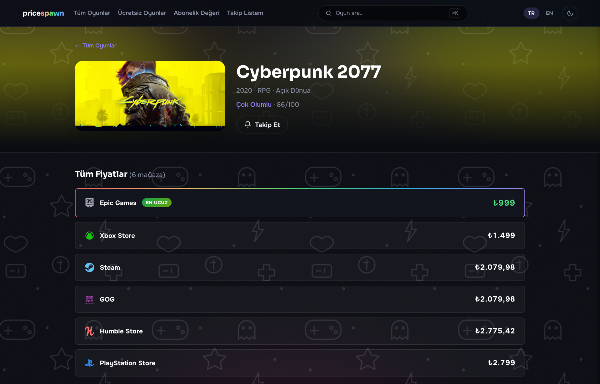
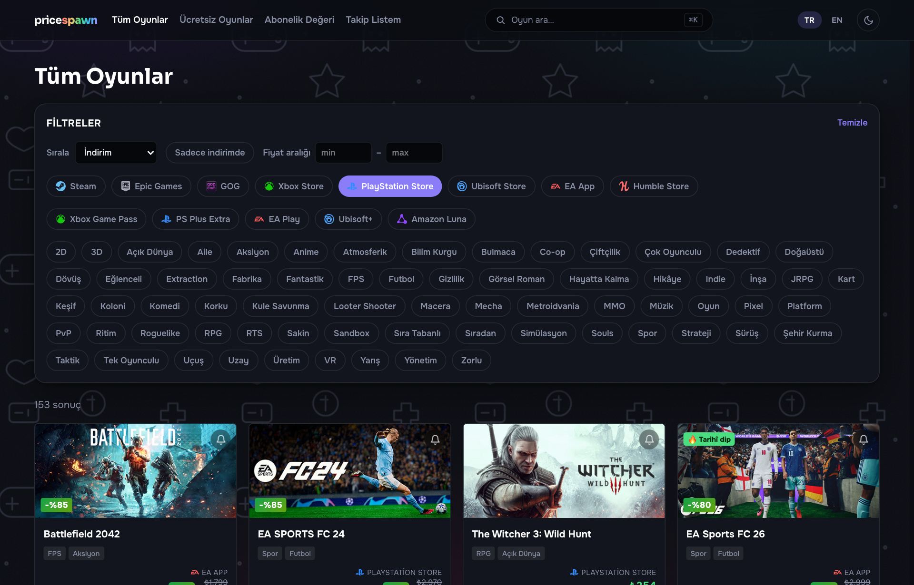
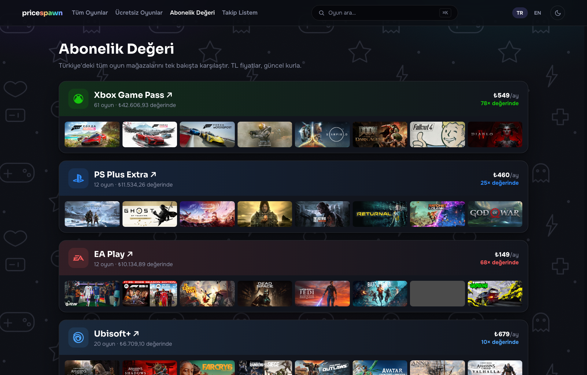

  
  
  
  

<em>Real Turkish lira prices for every game, across every digital store, side by side. 
This repository is the public showcase; the source code is kept private.</em>

## What it is

PriceSpawn answers one question: where is this game cheapest in Türkiye right now? It compares Steam, Epic, GOG, Xbox, Ubisoft, Humble and PlayStation in real lira and highlights the lowest, with live discounts, historic lows, subscription inclusion and free games.

<table>
  <tr>
    <td width="50%"></td>
    <td width="50%"></td>
  </tr>
  <tr>
    <td width="50%"></td>
    <td width="50%"></td>
  </tr>
</table>

## Highlights

| | |
|---|---|
| **Real prices** | Live lira prices from every store, refreshed daily. Nothing is estimated or faked. |
| **Historic lows** | The true all-time low for each game, with store and date. |
| **Free games** | What is free on Epic right now. |
| **Subscription value** | What Game Pass, PS Plus and EA Play include, and what it is worth. |
| **Price alerts** | A watchlist with target prices, no sign-in. |
| **Fast search** | A ⌘K palette with Turkish-aware search, dark and light themes. |

## Türkçe özet

**PriceSpawn**, Türkiye için bir oyun fiyatı karşılaştırma sitesi. Steam, Epic, GOG, Xbox, Ubisoft, Humble ve PlayStation'daki gerçek TL fiyatlarını yan yana gösteriyor ve en ucuzunu vurguluyor. İndirimler, tarihî en düşük fiyatlar, abonelik dahilliği ve ücretsiz oyunlar canlı veriden geliyor. Bu depo sitenin vitrinidir; kaynak kod gizli.

 

Showcase only · Next.js, IsThereAnyDeal and Neon Postgres.

